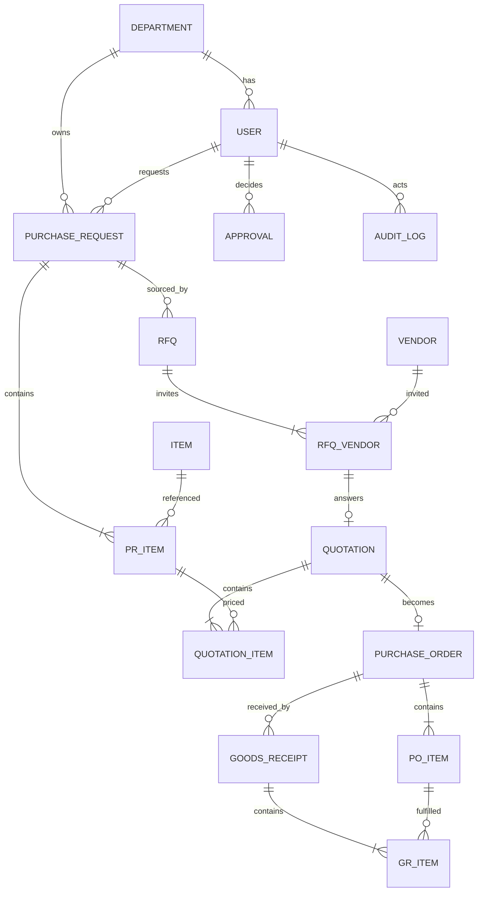

# Architect.md - Arsitektur Sistem

## 1. Gambaran Umum
Monolith Django dengan server-rendered templates. Dipilih karena auth, ORM, migration, dan permission sudah tersedia sehingga waktu fokus ke domain dan schema.

```
[Browser]
   |  HTTP (HTML + HTMX)
   v
[Django App - gunicorn]
   |-- views (tipis: parsing request, render)
   |-- services/ (logika bisnis, state machine, audit)
   |-- models (ORM)
   |         |
   |         v
   |   [SQLite (dev) | PostgreSQL (docker)]
   |
   +--> media/ (lampiran quotation)
   +--> services/ai_extractor.py --> [Claude API vision] (opsional, ada fallback manual)
```

## 2. Tech Stack
| Lapisan | Pilihan |
|---|---|
| Bahasa | Python 3.12 |
| Framework | Django 5.x |
| Frontend | Django Templates + Bootstrap 5 (CDN) + HTMX |
| Database | SQLite default, PostgreSQL via Docker Compose |
| Config | `django-environ` / env var, `.env.example` |
| Test | `pytest-django` |
| Lint/format | `ruff` |
| Deploy | Docker + docker-compose |

## 3. Struktur Repository
```
procurement/
├── manage.py
├── config/                  # settings, urls, wsgi
├── apps/
│   ├── accounts/            # User (role), permission decorator
│   ├── masterdata/          # Department, Item, Vendor
│   ├── requisitions/        # PurchaseRequest, PRItem
│   ├── approvals/           # Approval (generik)
│   ├── sourcing/            # RFQ, RFQVendor, Quotation, QuotationItem
│   ├── orders/              # PurchaseOrder, POItem
│   ├── receiving/           # GoodsReceipt, GRItem
│   └── audit/               # AuditLog
├── services/                # logika bisnis per domain
│   ├── state_machine.py     # tabel transisi + validator
│   ├── requisition_service.py
│   ├── approval_service.py
│   ├── sourcing_service.py
│   ├── order_service.py
│   ├── receiving_service.py
│   ├── audit_service.py
│   ├── numbering.py         # generator nomor dokumen
│   └── ai_extractor.py      # opsional
├── templates/
├── static/
├── tests/
├── scripts/seed_data.py
├── docs/ (BPMN.pdf, ERD.png)
├── law.bend
├── docker-compose.yml
├── Dockerfile
├── requirements.txt
├── .env.example
└── README.md
```

## 4. Layering
1. **View** -> validasi input (Form), cek role, panggil service, render. Tidak ada aturan bisnis.
2. **Service** -> satu-satunya tempat mengubah status, menjalankan aturan bisnis, dan menulis AuditLog, dibungkus `transaction.atomic`.
3. **Model** -> struktur data dan constraint; method ringan saja (properti turunan).

Perubahan status dokumen **hanya** lewat `services/state_machine.transition()`.

## 5. Database Schema (ERD)



### Tabel dan Kolom Kunci
| Tabel | Kolom penting | Constraint |
|---|---|---|
| `user` | username, role, department_id, is_active | role dalam enum |
| `department` | code, name, head_id | code unik |
| `item` | code, name, uom, is_active | code unik |
| `vendor` | code, name, contact, email, is_active | code unik |
| `purchase_request` | number, requester_id, department_id, needed_date, reason, status, created_at | number unik, index status |
| `pr_item` | pr_id, item_id, qty, notes | qty > 0, unik (pr_id, item_id) |
| `approval` | content_type, object_id, level, approver_id, status, notes, decided_at | index (content_type, object_id) |
| `rfq` | number, pr_id, due_date, status | number unik |
| `rfq_vendor` | rfq_id, vendor_id, sent_at | unik (rfq_id, vendor_id) |
| `quotation` | rfq_vendor_id, lead_time_days, valid_until, terms, attachment, status, selection_reason | OneToOne rfq_vendor |
| `quotation_item` | quotation_id, pr_item_id, unit_price | unit_price >= 0, unik (quotation_id, pr_item_id) |
| `purchase_order` | number, quotation_id, vendor_id, status, total_amount, issued_by_id | number unik, OneToOne quotation |
| `po_item` | po_id, item_id, qty, unit_price | qty > 0 |
| `goods_receipt` | number, po_id, delivery_note_no, received_date, received_by_id | number unik |
| `gr_item` | gr_id, po_item_id, qty_received, condition, notes | qty_received > 0 |
| `audit_log` | content_type, object_id, from_status, to_status, user_id, note, created_at | append-only, index objek |

Keputusan desain:
- **Approval generik** (GenericForeignKey) agar PR, quotation, dan PO memakai satu mekanisme.
- `PO_ITEM` menyalin qty dan harga dari quotation (snapshot) agar PO tidak berubah jika data lain berubah.
- `AuditLog` append-only (tanpa update/delete).
- Tidak ada tabel stok dan pembayaran (out of scope).
- Uang memakai `DecimalField(max_digits=15, decimal_places=2)`.

## 6. State Machine
Didefinisikan sebagai dict transisi di `services/state_machine.py`:
```python
TRANSITIONS = {
  "PR": {"DRAFT": {"SUBMITTED", "CANCELLED"},
         "SUBMITTED": {"APPROVED", "REJECTED", "CANCELLED"},
         "REJECTED": {"DRAFT"},
         "APPROVED": {"IN_SOURCING", "CANCELLED"},
         "IN_SOURCING": {"PO_ISSUED", "CANCELLED"},
         "PO_ISSUED": {"PARTIALLY_RECEIVED", "COMPLETED"},
         "PARTIALLY_RECEIVED": {"COMPLETED"}},
  # RFQ, QUOTATION, PO didefinisikan serupa (lihat SRS bagian 4)
}
```
`transition(obj, to_status, user, note)` memvalidasi, memperbarui status, menulis AuditLog, semuanya atomik.

## 7. Alur Request Utama
```
Requester -> PR(DRAFT) -> submit -> Approval(PENDING)
Dept Head -> approve -> PR(APPROVED)
Officer -> RFQ(SENT) -> Quotation(SUBMITTED)xN -> pilih -> Approval(Manager)
Manager -> approve -> Officer terbit PO(PENDING_APPROVAL) -> Manager approve -> PO(SENT)
Receiver -> GR (qty <= sisa) -> PO(PARTIALLY_RECEIVED | COMPLETED)
```

## 8. Integrasi AI (opsional)
- `services/ai_extractor.extract_quotation(file) -> ExtractionResult` memanggil Claude API (vision) dengan prompt yang memaksa output JSON.
- Output divalidasi (schema) sebelum dipakai; nilai tidak valid dibuang.
- Hasil hanya prefill form, tidak pernah auto-save.
- Timeout 20 detik, error ditangkap, fallback ke input manual.
- API key dari `ANTHROPIC_API_KEY` (env), tidak pernah di-commit.

## 9. Deployment
`docker-compose.yml`: service `web` (gunicorn) + `db` (postgres:16). Tanpa Docker: `pip install -r requirements.txt`, `migrate`, `seed_data`, `runserver` (SQLite).

## 10. Testing
- Unit: state machine (transisi valid dan invalid), numbering, perhitungan total.
- Service: BR-01 sampai BR-06 (self-approval, over-receipt, dsb).
- Smoke: alur end-to-end happy path dan skenario PR ditolak.
