# BPMN Swimlane - Aplikasi Procurement

Versi: 1.0 | Rujukan: `PRD.md`, `SRS.md`, `Architect.md`

## 1. Tujuan proses

Menggambarkan proses pengadaan end-to-end dari kebutuhan barang/jasa sampai barang diterima,
melibatkan lebih dari dua role:

- Admin
- Requester
- Dept Head
- Procurement Officer
- Procurement Manager
- Warehouse Receiver
- Vendor (lane eksternal, tidak memiliki akun/login)
- Sistem (audit, state machine, dashboard)

## 2. Diagram swimlane

Salin diagram di bawah ke [Mermaid Live Editor](https://mermaid.live), lalu **Export PNG/SVG/PDF**.
Diagram juga dapat dirender langsung oleh ekstensi Mermaid di VS Code.

```mermaid
%%{init: {"flowchart": {"curve": "step", "nodeSpacing": 35, "rankSpacing": 70}} }%%
flowchart LR
  Start((Mulai:<br/>kebutuhan<br/>pengadaan)) --> R1

  subgraph ADM["Admin"]
    A1["Kelola master data<br/>department, item,<br/>vendor, user"]
  end

  subgraph REQ["Requester"]
    R1["Buat PR multi-item<br/>status DRAFT"]
    R2["Submit PR"]
    R3["Revisi PR"]
    R4["Batalkan PR"]
  end

  subgraph DH["Dept Head"]
    D1{"Review PR"}
    D2["Reject + alasan"]
    D3["Approve PR"]
  end

  subgraph OFF["Procurement Officer"]
    O1["Review PR<br/>APPROVED"]
    O2["Buat RFQ<br/>pilih >= 1 vendor"]
    O3["Kirim RFQ"]
    O4["Input quotation<br/>per vendor"]
    O5["Bandingkan<br/>penawaran"]
    O6{"Pilih vendor"}
    O7["Isi justifikasi<br/>jika bukan termurah"]
    O8["Quotation<br/>SELECTED"]
    O9["Revisi quotation"]
    O10["Terbitkan PO"]
    O11["Kirim PO"]
    O12["Revisi /<br/>batalkan PO"]
  end

  subgraph VEN["Vendor (eksternal, tanpa login)"]
    V1["Terima RFQ<br/>di luar sistem"]
    V2["Siapkan<br/>penawaran"]
    V3["Kirim penawaran<br/>ke Officer"]
    V4["Terima PO<br/>di luar sistem"]
    V5["Kirim barang/jasa"]
  end

  subgraph MGR["Procurement Manager"]
    M1{"Setujui vendor<br/>terpilih?"}
    M2["Reject vendor<br/>+ alasan"]
    M3["Approve vendor"]
    M4{"Setujui PO?"}
    M5["Reject PO<br/>+ alasan"]
    M6["Approve PO"]
  end

  subgraph WH["Warehouse Receiver"]
    W1["Buat Goods Receipt<br/>surat jalan, qty, kondisi"]
    W2{"Qty <= sisa PO?"}
    W3["Tolak / koreksi qty"]
    W4["Simpan GR"]
    W5{"Semua item<br/>terpenuhi?"}
    W6["PO & PR<br/>PARTIALLY_RECEIVED"]
    W7["PO & PR<br/>COMPLETED"]
  end

  subgraph SYS["Sistem (otomatis)"]
    S1["Validasi transisi<br/>state machine"]
    S2["Tulis AuditLog<br/>setiap perubahan status"]
    S3["Dashboard &<br/>antrean tugas per role"]
  end

  A1 -.->|"master data siap"| R1
  R1 --> R2
  R2 --> D1
  D1 -->|"Reject"| D2
  D2 --> R3
  R3 --> R2
  D1 -->|"Approve"| D3
  D3 --> O1
  R2 -.->|"batal"| R4

  O1 --> O2
  O2 --> O3
  O3 --> V1
  V1 --> V2
  V2 --> V3
  V3 --> O4
  O4 -.->|"ulangi untuk<br/>setiap vendor"| O4
  O4 --> O5
  O5 --> O6
  O6 -->|"bukan harga<br/>terendah"| O7
  O7 --> O8
  O6 -->|"harga terendah"| O8
  O8 --> M1

  M1 -->|"Reject"| M2
  M2 --> O9
  O9 --> O4
  M1 -->|"Approve"| M3
  M3 --> O10

  O10 --> M4
  M4 -->|"Reject"| M5
  M5 --> O12
  O12 --> O10
  M4 -->|"Approve"| M6
  M6 --> O11

  O11 --> V4
  V4 --> V5
  V5 --> W1
  W1 --> W2
  W2 -->|"Tidak"| W3
  W3 --> W1
  W2 -->|"Ya"| W4
  W4 --> W5
  W5 -->|"Belum lengkap"| W6
  W6 --> W1
  W5 -->|"Lengkap"| W7
  W7 --> End((Selesai))

  D3 -.-> S1
  O8 -.-> S1
  M3 -.-> S1
  M6 -.-> S1
  W4 -.-> S1
  S1 --> S2
  S1 --> S3

  classDef admin fill:#f3e8ff,stroke:#6f42c1,color:#3d1a6e;
  classDef requester fill:#e7f1ff,stroke:#0d6efd,color:#084298;
  classDef depthead fill:#fff3cd,stroke:#997404,color:#664d03;
  classDef officer fill:#d1e7dd,stroke:#198754,color:#0f5132;
  classDef manager fill:#f8d7da,stroke:#dc3545,color:#842029;
  classDef warehouse fill:#ffe5d0,stroke:#fd7e14,color:#7a3e00;
  classDef vendor fill:#e2e3e5,stroke:#6c757d,color:#41464b;
  classDef system fill:#cff4fc,stroke:#0dcaf0,color:#055160;

  class A1 admin;
  class R1,R2,R3,R4 requester;
  class D1,D2,D3 depthead;
  class O1,O2,O3,O4,O5,O6,O7,O8,O9,O10,O11,O12 officer;
  class M1,M2,M3,M4,M5,M6 manager;
  class W1,W2,W3,W4,W5,W6,W7 warehouse;
  class V1,V2,V3,V4,V5 vendor;
  class S1,S2,S3 system;
```



## 3. Alur utama (happy path)

1. **Admin** memastikan master data department, item, vendor, dan user tersedia.
2. **Requester** membuat PR multi-item (`DRAFT`), lalu submit (`SUBMITTED`).
3. **Dept Head** mereview dan meng-approve PR (`APPROVED`).
4. **Officer** membuat RFQ dari PR, memilih minimal satu vendor, lalu menandai RFQ terkirim
   (`SENT`). PR berubah menjadi `IN_SOURCING`.
5. **Vendor** menyiapkan penawaran di luar sistem dan mengirimkannya ke Officer.
6. **Officer** menginput quotation per vendor (`SUBMITTED`), lalu membandingkan penawaran.
7. **Officer** memilih vendor (`SELECTED`); justifikasi wajib bila bukan harga terendah.
8. **Manager** menyetujui vendor (`APPROVED`, RFQ `AWARDED`).
9. **Officer** menerbitkan PO (`PENDING_APPROVAL`).
10. **Manager** menyetujui PO (`APPROVED`).
11. **Officer** menandai PO terkirim (`SENT`) dan mencetak PO bila diperlukan.
12. **Vendor** mengirim barang/jasa.
13. **Warehouse** membuat GR. Jika qty belum lengkap, PO/PR menjadi `PARTIALLY_RECEIVED`;
    jika seluruh item terpenuhi, PO/PR menjadi `COMPLETED`.

## 4. Jalur alternatif dan exception

| Kejadian | Aktor | Hasil |
|---|---|---|
| PR ditolak Dept Head | Dept Head | PR `REJECTED`, alasan wajib; Requester revisi ke `DRAFT` lalu submit ulang |
| Vendor selection ditolak Manager | Manager | Quotation `REJECTED`; Officer revisi dan submit ulang (`SUBMITTED`) |
| PO ditolak Manager | Manager | PO `REJECTED`; Officer revisi dan ajukan ulang atau batalkan |
| Qty GR melebihi sisa | Warehouse | Ditolak dengan pesan validasi; qty harus dikoreksi |
| Penerimaan sebagian | Warehouse | PO/PR `PARTIALLY_RECEIVED`; GR berikutnya melanjutkan sisa qty |
| PR dibatalkan | Requester/Officer/Manager/Admin | PR `CANCELLED` selama transisi diizinkan state machine |
| PO dibatalkan | Officer/Manager/Admin | PO `CANCELLED` selama transisi diizinkan state machine |
| AI extractor gagal | Sistem | Pesan error ditampilkan; input manual tetap tersedia |

## 5. Aturan status (state machine)

```text
PurchaseRequest:
DRAFT -> SUBMITTED -> APPROVED -> IN_SOURCING -> PO_ISSUED
      -> PARTIALLY_RECEIVED -> COMPLETED
SUBMITTED/APPROVED/IN_SOURCING -> CANCELLED
REJECTED -> DRAFT (revisi)

RFQ:
DRAFT -> SENT -> CLOSED -> AWARDED
DRAFT/SENT -> CANCELLED

Quotation:
SUBMITTED -> SELECTED -> APPROVED | REJECTED
REJECTED -> SUBMITTED (revisi)

PurchaseOrder:
PENDING_APPROVAL -> APPROVED -> SENT -> PARTIALLY_RECEIVED -> COMPLETED
PENDING_APPROVAL -> REJECTED -> PENDING_APPROVAL (revisi)
PENDING_APPROVAL/REJECTED/APPROVED -> CANCELLED
```

## 6. Catatan BPMN

- **Vendor tidak login.** Lane vendor menggambarkan aktivitas eksternal; sistem hanya mencatat
  RFQ/PO sebagai `SENT`.
- **Tidak ada lane gudang/stok.** Warehouse hanya mencatat penerimaan, bukan mutasi/stok.
- **Tidak ada lane pembayaran.** Invoice/payment di luar scope.
- Setiap task yang mengubah status harus melewati `services/state_machine.transition()` dan
  menghasilkan satu baris `AuditLog`.
- Approval PR satu level (Dept Head) dan approval PO/vendor satu level (Procurement Manager).
